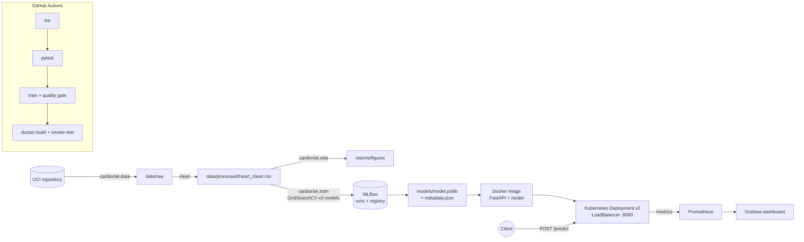

# Heart Disease Risk — End-to-End MLOps (BITS AIMLCZG523, Assignment 1)

A classifier that predicts presence of heart disease from 13 clinical features (UCI Cleveland
dataset), tracked with MLflow, tested and trained in GitHub Actions, served by FastAPI in Docker,
deployed to Kubernetes, and monitored with Prometheus + Grafana.

> Educational project. Not a medical device.

## Architecture



## Task-to-file map

| Task (marks) | Main files | Command |
|---|---|---|
| 1 Data + EDA (5) | `cardiorisk/data.py`, `cardiorisk/eda.py`, `notebooks/01_eda.ipynb` | `python -m cardiorisk.data` then `python -m cardiorisk.eda` |
| 2 Features + models (8) | `cardiorisk/features.py`, `cardiorisk/train.py` | `python -m cardiorisk.train --no-tracking` (Task 2 alone, no MLflow) |
| 3 Experiment tracking (5) | `cardiorisk/train.py` (`MlflowTracker`) | `python -m cardiorisk.train`, then `mlflow ui --backend-store-uri sqlite:///mlflow.db` |
| 4 Packaging (7) | `models/`, `requirements*.txt`, MLflow registry | produced by `python -m cardiorisk.train` |
| 5 CI/CD + tests (8) | `tests/`, `.github/workflows/ci.yml`, `setup.cfg` | `flake8 ...`, `pytest -v`, `git push` |
| 6 Container (5) | `api/`, `Dockerfile`, `requirements-api.txt` | `docker build -t heart-risk-api:1.0.0 .` |
| 7 Kubernetes (7) | `k8s/` | `kubectl apply -f k8s/namespace.yaml` then deployment + service |
| 8 Monitoring (3) | `api/monitoring.py`, `monitoring/` | `docker compose up -d --build` in `monitoring/` |
| 9 Documentation (2) | `README.md`, `screenshots/`, report | — |

## Repository layout

```
cardiorisk/            Python package: config, data, features, eda, train
api/                   FastAPI app (main.py), request/response schemas, metrics + JSON logging
tests/                 pytest suite (runs offline on synthetic data shaped like the UCI file)
notebooks/             01_eda, 02_training, 03_inference (thin wrappers over the package)
scripts/               smoke_test.py, send_traffic.py, sample_request.json
k8s/                   namespace, deployment, service (LoadBalancer), optional ingress
monitoring/            docker-compose with API + Prometheus + Grafana (dashboard provisioned)
.github/workflows/     ci.yml: lint -> test -> train -> docker
data/                  downloaded raw + generated cleaned dataset (regenerated by Task 1)
models/                generated trained pipeline + metadata (created by Tasks 2–4)
reports/figures/       EDA and model plots (generated)
screenshots/           evidence for the report (see screenshots/README.md)
```

## Prerequisites (install once)

| Tool | Why | Check |
|------|-----|-------|
| Python **3.13** | everything Python | `python --version` |
| Git + a GitHub account | repo + Actions | `git --version` |
| Docker Desktop (Settings → Kubernetes → Enable; this project was verified with the kind-based Docker Desktop cluster) | container + local K8s | `docker version`, `kubectl get nodes` |
| VS Code (optional) | editor + notebook runner | |

Minikube works instead of Docker Desktop's Kubernetes; differences are noted below.

## Step-by-step (all commands from the repository root)

### 1. Environment
```bash
python -m venv .venv
# Windows PowerShell:   .venv\Scripts\Activate.ps1
# macOS / Linux:        source .venv/bin/activate
pip install --upgrade pip
pip install -r requirements.txt
```

### 2. Data + EDA (Task 1)
```bash
python -m cardiorisk.data      # downloads data/raw/processed.cleveland.data, writes data/processed/heart_clean.csv
python -m cardiorisk.eda       # writes reports/figures/eda_*.png
```
Or open `notebooks/01_eda.ipynb` (`jupyter lab`, or VS Code) and Run All.
If the download is blocked, download `processed.cleveland.data` manually from the
[UCI Heart Disease page](https://archive.ics.uci.edu/dataset/45/heart+disease) and put it in `data/raw/`.

### 3. Train + track (Tasks 2–4)
```bash
python -m cardiorisk.train
mlflow ui --backend-store-uri sqlite:///mlflow.db --port 5000    # open http://127.0.0.1:5000
```
Training prints a comparison table, logs 47 MLflow runs (1 session, 3 model families,
43 grid candidates) plus the EDA figures, registers the winner as `heart-disease-risk-classifier`, and writes
`models/model.joblib` + `models/model_metadata.json`. It exits with code 1 if the selected
model's test ROC-AUC is below the configured quality gate (default 0.80; use `--min-test-auc` or env `MIN_TEST_ROC_AUC` to change).

To show Task 2 on its own, run `python -m cardiorisk.train --no-tracking`: same training,
comparison, quality gate and saved model, with no MLflow involved (it works even without MLflow installed).

### 4. Tests + lint (Task 5, locally)
```bash
flake8 cardiorisk api tests scripts
pytest -v
```

### 5. Run the API without Docker (quick check)
```bash
uvicorn api.main:app --port 8000
# new terminal:
python scripts/smoke_test.py
```
Swagger UI: http://localhost:8000/docs

### 6. Docker (Task 6)
```bash
docker build -t heart-risk-api:1.0.0 .
docker run -d --name heart-api -p 8000:8000 heart-risk-api:1.0.0
python scripts/smoke_test.py
docker logs heart-api              # JSON request logs
docker rm -f heart-api             # stop before step 7/8 to free port 8000
```
Example request. On Windows PowerShell type `curl.exe` (plain `curl` is an alias for a different
command there); the quotes around `@scripts/...` are required in PowerShell.
```bash
curl -X POST http://localhost:8000/predict -H "Content-Type: application/json" -d "@scripts/sample_request.json"
```

### 7. Kubernetes (Task 7)
Docker Desktop's Kubernetes can use the locally built image directly.
```bash
kubectl config use-context docker-desktop
kubectl apply -f k8s/namespace.yaml
kubectl apply -f k8s/deployment.yaml -f k8s/service.yaml
kubectl rollout status deployment/heart-risk-api -n heart-risk
kubectl get all -n heart-risk
python scripts/smoke_test.py --url http://localhost:8080
kubectl logs -n heart-risk -l app=heart-risk-api --tail=20
```
**Minikube instead:** `minikube start`, then `minikube image load heart-risk-api:1.0.0`, apply the
same manifests, and run `minikube tunnel` in a separate terminal so the LoadBalancer gets an IP
(or use `minikube service heart-risk-api -n heart-risk --url`).

### 8. Monitoring (Task 8)
```bash
cd monitoring
docker compose up -d --build
cd ..
python scripts/send_traffic.py --n 300
```
- Prometheus targets: http://localhost:9090/targets (`heart-risk-api` should be UP;
  `heart-risk-api-k8s` is UP only while the Kubernetes deployment from step 7 is running)
- Grafana: http://localhost:3000 (admin / admin) → dashboard "Heart Risk API"

Stop with `docker compose -f monitoring/docker-compose.yml down`.

### 9. CI/CD (Task 5)
Push to GitHub. `.github/workflows/ci.yml` runs on every push/PR to `main`:
1. **lint** – flake8 (fails the pipeline on style/syntax errors)
2. **test** – pytest + coverage, JUnit XML uploaded
3. **train** – data → EDA → training with quality gate; model, MLflow store, figures and logs uploaded
4. **docker** – builds the image with the CI-trained model, runs it, smoke-tests `/predict`, uploads container logs

Each job uploads its logs as artifacts (`if: always()`, so logs exist even when a job fails).

## API reference

| Method | Path | Purpose |
|--------|------|---------|
| POST | `/predict` | one patient → prediction, P(disease), confidence, risk band, model version |
| POST | `/predict/batch` | `{"instances": [...]}` up to 100 patients |
| GET | `/health` | readiness: 200 only when a model is loaded (K8s readinessProbe) |
| GET | `/live` | liveness (K8s livenessProbe) |
| GET | `/model-info` | training metadata of the loaded model |
| GET | `/metrics` | Prometheus metrics |

Invalid input (out-of-range values, unknown codes, missing or extra fields) returns HTTP 422.
Every response carries an `X-Request-ID` header that also appears in the JSON logs.

## Key design decisions
- **Imputation inside the pipeline, not in the cleaned CSV** – learned on training rows only
  (no leakage) and applied identically when serving.
- **One config module** (`cardiorisk/config.py`) defines features and valid ranges for both
  cleaning and API validation, so training and serving cannot drift apart.
- **Model selection on CV ROC-AUC, not on the test set** – the test split is touched once, for reporting.
- **Threshold metrics use P(disease) ≥ 0.5 everywhere** (CV, test, API). sklearn's default scorers
  use `predict()`, which for an SVM with `probability=True` is a different rule.
- **Permutation importance** on raw features, so the explanation plots are comparable across
  LR, RF and SVM.
- **Quality gate** in training stops CI if model quality regresses.

## Troubleshooting
- `docker build` fails at `COPY models/...` → run training first (step 3).
- Port 5000 busy on macOS (AirPlay) → `mlflow ui ... --port 5001`.
- PowerShell refuses to activate the venv → `Set-ExecutionPolicy -Scope CurrentUser RemoteSigned`.
- K8s pods `ErrImagePull` / `ImagePullBackOff` → the cluster cannot see your local image.
  Docker Desktop: this project was verified with the kind-based Kubernetes cluster. The local image is loaded into the cluster's containerd `k8s.io` image store before deployment.
  Minikube: `minikube image load heart-risk-api:1.0.0`.
- `EXTERNAL-IP <pending>` on Minikube → `minikube tunnel` must be running.


## Reproducibility note

The repository includes the current trained model artifact (`models/model.joblib`) and metadata for immediate deployment and reproducibility. The model can also be regenerated from scratch: a fresh clone can run Task 1 to acquire and clean the UCI Cleveland data, then Tasks 2–4 to train, track, and package a new model. The same top-level dependency pins and Python 3.13 target are used locally, in GitHub Actions, and in the Docker image.

The data cleaning step deliberately retains missing feature cells rather than filling them globally. Imputation is learned inside the scikit-learn pipeline from training folds only, preventing test-set leakage.
