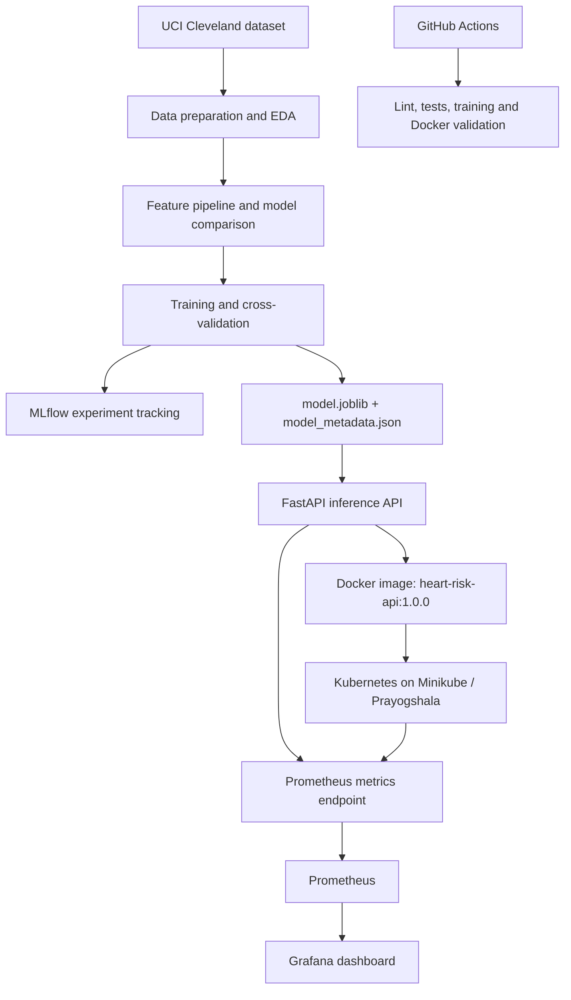

[README_Prayogshala_updated.md](https://github.com/user-attachments/files/33600237/README_Prayogshala_updated.md)
# Heart Disease Risk — End-to-End MLOps

**BITS Pilani | AIMLCZG523 — MLOps Assignment 1**  
**Repository:** [piyushshukla1234321/heart-disease-mlops](https://github.com/piyushshukla1234321/heart-disease-mlops)

An end-to-end machine-learning operations project for predicting the presence of heart disease from 13 clinical features in the UCI Cleveland Heart Disease dataset. The project covers data preparation, model comparison and training, experiment tracking, API packaging, Kubernetes deployment, automated checks, and operational monitoring.

> **Educational project only. Not a medical device and not intended for clinical decision-making.**

## Current demonstrated architecture

The current deployment/evidence environment is **Prayogshala (BITS Pilani) using Minikube**, not Docker Desktop Kubernetes.



### Runtime components

- **Training and artifacts:** scikit-learn pipeline; trained artifact at `models/model.joblib` and metadata at `models/model_metadata.json`.
- **Experiment tracking:** MLflow records model parameters and metrics for training runs.
- **Serving:** FastAPI exposes prediction, health, model-information and Prometheus metrics endpoints. The API is packaged as `heart-risk-api:1.0.0`.
- **Deployment:** Kubernetes manifests under `k8s/` deploy the API to the `heart-risk` namespace in Minikube on Prayogshala. The Service is configured as `LoadBalancer`; Minikube's tunnel may be needed to assign an external IP.
- **Monitoring:** Prometheus and Grafana are run separately using `monitoring/docker-compose.yml`. Prometheus scrapes both the Compose-hosted API and the Kubernetes API when the Kubernetes forwarding target is running. Grafana visualizes model-loaded status, prediction counts, predicted-disease share, error rate, request rate and prediction latency.
- **CI/CD:** GitHub Actions workflow under `.github/workflows/` runs linting, tests, training and Docker validation. See the repository's Actions tab for the latest run status.

The monitoring stack is separate from the Kubernetes deployment. The Docker Compose API target is a monitoring/demo service; it should not be confused with the API deployed to Minikube.

## Repository layout

```text
cardiorisk/             Data, configuration, features, EDA and training package
api/                    FastAPI app, schemas, metrics and request logging
data/                   Raw/processed dataset files (some generated during setup)
models/                 Trained model artifact and metadata
k8s/                    Kubernetes namespace, deployment, service and ingress manifests
monitoring/             Docker Compose, Prometheus config and provisioned Grafana dashboard
notebooks/              EDA, training and inference notebooks
scripts/                Smoke test, sample request and traffic-generation helpers
tests/                  Automated tests
.github/workflows/      GitHub Actions CI workflow
reports/                Evaluation outputs, CSVs and figures
screenshots/            Evidence screenshots and screenshot notes
```

## Prerequisites

- Python version compatible with the repository's `PYTHON_VERSION` and dependency pins
- Git
- Docker Engine / Docker Compose for the monitoring stack and image build
- Minikube and its bundled `kubectl` command for the demonstrated Prayogshala Kubernetes workflow
- MLflow for experiment tracking

Commands below assume a Linux shell and are run from the repository root unless indicated otherwise. On Prayogshala, use `minikube kubectl -- ...` if standalone `kubectl` is not installed.

## Reproduce the ML workflow

### 1. Set up Python

```bash
python --version
python -m venv .venv
source .venv/bin/activate
python -m pip install --upgrade pip
pip install -r requirements.txt
```

### 2. Prepare data and run EDA

```bash
python -m cardiorisk.data
python -m cardiorisk.eda
```

The data command downloads/prepares the UCI Cleveland data and writes the cleaned dataset. EDA outputs are written under `reports/figures/`. If the source download is unavailable, follow the dataset instructions in `cardiorisk/data.py` and place the raw file in the expected `data/raw/` location.

### 3. Train and track experiments

```bash
python -m cardiorisk.train
```

This runs model comparison/training, logs experiment information to MLflow, and writes the trained model and metadata to `models/`. To run training without MLflow tracking, use:

```bash
python -m cardiorisk.train --no-tracking
```

Start the MLflow UI from the repository root if you want to inspect runs:

```bash
mlflow ui --backend-store-uri sqlite:///mlflow.db --port 5000
```

Open `http://localhost:5000`. Use the run metrics and artifacts shown in MLflow as the source of truth for the run being discussed; metrics can differ between runs if the data, configuration or code changes.

### 4. Run tests and lint

```bash
flake8 cardiorisk api tests scripts
pytest -v
```

### 5. Run the API locally (optional smoke test)

```bash
uvicorn api.main:app --host 0.0.0.0 --port 8000
```

In another terminal, run:

```bash
python scripts/smoke_test.py --url http://localhost:8000
```

API documentation is available at `http://localhost:8000/docs`.

## Deploy to Kubernetes on Prayogshala (Minikube)

Run from the repository root. Ensure Minikube is started and the image is available to the cluster.

```bash
minikube start
# Build the image if it is not already available locally:
docker build -t heart-risk-api:1.0.0 .
# Load the local image into Minikube:
minikube image load heart-risk-api:1.0.0
# Apply the manifests:
minikube kubectl -- apply -f k8s/namespace.yaml
minikube kubectl -- apply -f k8s/deployment.yaml
minikube kubectl -- apply -f k8s/service.yaml
# Wait for the deployment:
minikube kubectl -- rollout status deployment/heart-risk-api -n heart-risk
minikube kubectl -- get pods -n heart-risk
```

The Service is configured as `LoadBalancer`. If an external IP is required, run the following in a **separate terminal and leave it running**:

```bash
minikube tunnel
```

Use the external IP and Service port shown by Kubernetes to call the API. The `/health` endpoint should return HTTP 200 when the model is loaded. Other useful endpoints are `/live`, `/model-info`, `/predict`, and `/metrics`.

If Prayogshala restarts, the Minikube cluster and foreground processes may need to be started again. Start Minikube first, then apply the manifests if the Kubernetes resources are not present, and restart the tunnel/port-forward processes required by the current monitoring configuration. Do not assume an old terminal process survived a restart.

## Monitoring with Prometheus and Grafana

The monitoring stack is separate from Kubernetes and is defined in `monitoring/docker-compose.yml`.

```bash
docker compose -f monitoring/docker-compose.yml up -d
```

Open:

- Prometheus targets: `http://localhost:9090/targets`
- Grafana: `http://localhost:3000`

The provisioned dashboard is named **Heart Risk API**. Prometheus should show the Compose API target as UP. The Kubernetes target is UP only while the Kubernetes API is reachable through the host port/forward configured in `monitoring/prometheus.yml`; if it is DOWN, check that the relevant Minikube port-forward is running and that the configured target port matches it.

Generate additional API traffic if desired:

```bash
python scripts/send_traffic.py --n 30
```

Stop the monitoring stack with:

```bash
docker compose -f monitoring/docker-compose.yml down
```

## GitHub Actions

The workflow in `.github/workflows/` runs on pushes and pull requests to `main`. It performs code-quality checks and tests, runs the training workflow, and validates the Docker image/API. The repository's Actions page is the authoritative place to verify the latest run result and inspect logs/artifacts.

## API endpoints

| Method | Endpoint | Purpose |
|---|---|---|
| `POST` | `/predict` | Predict for one patient |
| `POST` | `/predict/batch` | Batch predictions |
| `GET` | `/health` | Readiness check; confirms that the model is loaded |
| `GET` | `/live` | Liveness check |
| `GET` | `/model-info` | Metadata for the loaded model |
| `GET` | `/metrics` | Prometheus metrics |
| `GET` | `/docs` | Interactive API documentation |

Input validation errors return HTTP 422. Responses include an `X-Request-ID` header; request logging uses the request ID to correlate API activity.

## Design and reproducibility notes

- Missing values are handled inside the scikit-learn pipeline so imputation is learned from training data rather than globally from the dataset.
- Feature definitions and valid ranges are centralized in `cardiorisk/config.py` for consistency between data preparation and API validation.
- Model selection uses cross-validation metrics rather than selecting on the held-out test set.
- The repository contains a trained model artifact and metadata for deployment without retraining. Re-running the data and training steps can regenerate artifacts; results depend on the checked-out code, dependencies, data and configuration.
- Do not treat example metrics or a dashboard's current counters as permanent benchmark results. Use the current report/MLflow run for exact evaluation figures.

## Troubleshooting

- **ImagePullBackOff / ErrImagePull:** make sure the image exists locally and has been loaded into Minikube with `minikube image load heart-risk-api:1.0.0`.
- **LoadBalancer external IP remains pending:** start `minikube tunnel` in a separate terminal and keep it running.
- **Kubernetes Prometheus target is DOWN:** ensure the API deployment is running and the port-forward configured by `monitoring/prometheus.yml` is active; the configured target port and the forwarded port must match.
- **MLflow port 5000 is busy:** use another port, for example `--port 5001`.
- **Docker build cannot find model artifacts:** run the training workflow first or confirm that `models/model.joblib` and `models/model_metadata.json` are present.

## License and intended use

This is an educational assignment repository. Unless a license file is added, no open-source license is granted by this README. The model is for learning and demonstration only, not medical advice or clinical use.
